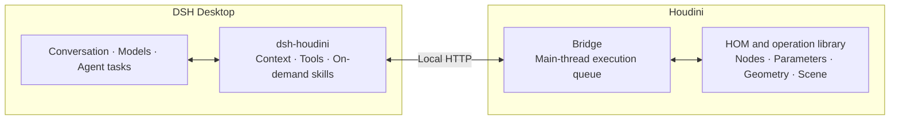

# dsh-houdini

[简体中文](README.md) | **English**


**Build, inspect, and maintain editable Houdini projects with natural language.**

dsh-houdini connects live Houdini scenes to [DeepSeek Harness Desktop](https://github.com/deepseek-ai/deepseek-harness). Describe your goal in a single conversation, and the Agent can inspect the scene, create and modify nodes, adjust parameters, build tools, and iterate using actual execution results.

The results remain native node networks, control parameters, keyframes, HDAs, and project files. You can review how they were built, edit them manually, or continue refining them through conversation.

[Key Capabilities](#key-capabilities) · [Quick Start](#quick-start) · [How It Works](#how-it-works) · [Documentation](#documentation)

## Key Capabilities

| Capability | What you can do |
|---|---|
| Scene understanding and diagnostics | Inspect nodes, parameters, connections, and geometry; examine Cook errors and dependencies; use UI screenshots and previews to locate problems. |
| Procedural modeling | Use SOPs, attributes, VEX, and Python to build editable networks, expose control parameters, make local changes, and check geometry. |
| HDAs and artist tools | Package workflows into HDAs; create parameter interfaces, Shelves, Python Panels, Viewer States, and Packages; organize source code, resources, and entry points. |
| Materials, lighting, and rendering | Work with UVs and textures; build MaterialX / Solaris / Karma workflows; configure cameras and lights and generate previews or rendered output; use COP layers and image processing when needed. |
| Parameter controls and animation | Set parameter dependencies and keyframes, organize mechanical hierarchies, rigs, and animation networks, and observe actual output after control values change. |
| Reference-assisted workflows | Work from text, images, reference pictures, and videos; use configured models to generate or edit images, transcribe narration, extract frames, and organize steps backed by source references. |
| Project organization and delivery | Organize node naming, grouping, subnets, outputs, and resource paths; save HIP files, tool source code, and related files for further editing and reuse. |
| Long-running tasks and execution recovery | Observe renders or computations through DSH background jobs, retrieve results for the original request, build and validate in isolated Houdini processes, and inspect execution records and errors. |

These capabilities can be combined: start by inspecting an existing network, turn it into a parameterized asset, and package it as a tool; or start from reference material, build a scene, and prepare a presentation. The Agent chooses the appropriate approach based on your goal, the existing project, and currently available capabilities.

## Quick Start

### Requirements

| Item | Supported range |
|---|---|
| Operating system | Windows x64 |
| Host | Plugin 0.1.8 requires DSH 0.2.2-rc.1. Users on DSH 0.2.1-rc.5 / rc.3 must explicitly select older plugin version 0.1.6. Confirm the host version before upgrading the plugin. See the [compatibility matrix](dsh-runtime-compatibility.json) for exact supported combinations and validation boundaries. |
| Houdini | 21.0 / 22.0; see the [installation guide](docs/setup.md) for build compatibility information. |
| Models | Configure an available primary chat model in DSH. Image understanding, image generation, and speech features depend on the actual capabilities of the selected models and services. |

### Installation

1. Install a compatible version of the official DSH Desktop and Houdini, then configure the primary model in DSH's native model settings.
2. In Desktop, open **Plugins → Add Plugin → Package name or address**, enter the full address below, and click **Install**. Alternatively, download the `.tgz` from the official release page and enter its local absolute path.
3. Click **Enable Now**, or enable `dsh-houdini` from the plugin list.

```text
https://github.com/eee1723/dsh-houdini/releases/download/v0.1.8/dsh-houdini-0.1.8.tgz
```

The [GitHub release package and checksum files](https://github.com/eee1723/dsh-houdini/releases/tag/v0.1.8) provide the complete installation package; no extraction or script execution is required. For subsequent updates to an address-installed version, use native plugin management as described in the [update instructions](docs/setup.md#connection--support连接与维护).

Before installing by [npm package name](https://www.npmjs.com/package/dsh-houdini), confirm that the selected registry has published the target version and that the version supports your current DSH. Entering only `dsh-houdini` queries that registry's `latest` tag; it does not automatically find a version compatible with the current host. If a mirror lacks a published version, switch to the official registry. If upstream has not published the version yet, changing registries will not help; use an existing official installation URL instead.

Newly installed plugins are disabled by default and provide Houdini mode only after being enabled. The full package includes FFmpeg / ffprobe, and a standard Python interpreter is located automatically from the Houdini installation. Using the plugin requires no separate Node installation, source compilation, or FFmpeg PATH configuration.

See the [installation and usage guide](docs/setup.md) for installation, component updates, legacy entry migration, and uninstallation.

### Connect to a Scene

| Entry point | How to connect |
|---|---|
| From DSH Desktop | Start or select a conversation in **Houdini mode**, bind a connected window through the project controls, or choose a Houdini installation to create a scene or open a HIP file. |
| From Houdini | Select **DSH-Houdini → Open Workspace** to enter the corresponding Houdini conversation in the same Desktop, based on the current project. |

After the plugin is enabled or updated, connection components are installed or updated automatically. New projects reuse the same preparation process, so manual installation is normally unnecessary. If an existing window still has old components loaded, save and reopen that window; if preparation fails, the project menu provides a retry option. Each conversation can explicitly select its own project. Opening another HIP uses a new process by default, preserving existing windows.

Houdini controls appear with the current conversation's **Houdini mode**, while other modes retain the original DSH interface. For multi-project selection, workspaces, and resuming projects, see the [project usage guide](docs/multi-instance.md).

Houdini mode in Windows Desktop provides an **Always on Top** button so you can work with the scene and conversation side by side; returning to another mode restores the previous window level. If you need a ChatGPT/Codex subscription, you can install the community plugin [dsh-codex-subscription@3.1.8](https://github.com/WSL043/dsh-codex-subscription) through the official plugin manager. It is independently authorized and maintained, is not bundled with the Houdini release package, and models are still selected from DSH's native menu.

## Usage Examples

Describe your goal, the scope you want to modify, and anything that should be preserved. For example:

**Create a parameterized asset**

> Create a spiral staircase in the current scene, exposing the step count, width, and total height. Keep an editable SOP network and check the relationships between steps after changing parameters.

**Inspect and modify an existing network**

> Find out why my selected node chain has no geometry output. Locate and fix the problem within this chain, preserve the other networks, and explain the changes and validation results.

**Build a reusable tool**

> Package this generator as an HDA, organize its inputs, outputs, and parameter interface, test it in a new instance, and explain the file location and how to load it.

**Create materials and a presentation**

> In this saved project, set up MaterialX materials, Karma lighting, and a camera for the selected asset. Render a preview and check material bindings and rendering errors.

**Learn from tutorial material**

> Analyze the construction method in this video. First organize the key steps, parameters, and source timestamps, then reproduce it in Houdini in stages, marking anything that is unclear in the original video.

Tasks can begin with observation, construction, modification, or troubleshooting. When modifying an existing project, specify the target and scope. For delivery, you can ask the Agent to show key networks, control parameters, actual outputs, and file locations. Evaluate the model's proposals using geometry, visual, and project checks.

## How It Works

DSH provides conversation and general Agent capabilities, while the plugin connects the model's operations to real Houdini. The main path for project operations is:



| Component | Responsibility |
|---|---|
| DSH Desktop | Manages models, accounts, credentials, sessions, workspaces, and general tasks, supporting continuous interaction between the user and Agent. |
| Plugin adapter | Provides Houdini mode, project context, tools, and interface elements; loads domain skills as needed and presents execution results. |
| Houdini Bridge | Receives requests inside Houdini, verifies project identity and operation scope, executes operations through the main-thread queue, and returns actual results. |

Houdini's Python API (HOM) runs only on the Houdini side. Media preparation runs in standard Python worker processes, while isolated builds and validation use one-shot Houdini processes; both are separate from main-thread execution in the current scene.

Execution results, errors, images, and files are returned to the original conversation so you can iterate on actual outcomes. If a request response is lost, the original request can be queried to reduce duplicate operations. DSH tracks long-running jobs, while operations within the same Houdini project remain serialized through the queue.

See the [system architecture](docs/architecture.md) for detailed responsibilities and source entry points. Tool parameters are documented in the [tool guide](docs/tools.md) and [operation catalog](docs/tool-design.md).

## Model and Extension Configuration

The primary chat model, accounts, and credentials are managed in DSH's native settings. Use a model with image input capability for visual understanding; image generation or editing can use a separately configured image service.

Configure speech transcription only when needed. In any mode, go to **Settings → Tutorial Videos** to select the address source, actual protocol, and exact model, confirm the scheduling settings, and save directly—no need to start a model conversation first. The Agent can also use the same configuration from a conversation. API keys are entered directly into the DSH credential service through a secure input and are not included in chat responses.

Existing DSH providers can be explicitly reused, and standalone speech services can be connected through their actual APIs. Media analysis alone does not require a scene connection. See [model and media settings](docs/setup.md#教程视频与转录设置) for configuration methods, dependencies, and supported interfaces.

## Documentation

| Entry point | Contents |
|---|---|
| [Installation and usage](docs/setup.md) | Installation, connection, updates, migration, model configuration, and uninstallation |
| [Multiple projects and recovery](docs/multi-instance.md) | Multiple windows, explicit binding, workspaces, and project recovery |
| [Tool guide](docs/tools.md) | Tool responsibilities, parameters, and return values |
| [Operation catalog](docs/tool-design.md) | Node, parameter, geometry, asset, observation, and rendering operations |
| [Project files and output](docs/project-files.md) | HIP files, images, resources, and output directories |
| [Execution records and diagnostics](docs/houdini-trace-design.md) | Execution, reference material, and diagnostic information in traces |
| [Support reports](docs/support-reports.md) | Collect, inspect, and export diagnostic material |
| [Documentation index](docs/README.md) | Complete design, interface, and maintenance documentation |

<details>
<summary>On-demand domain skills</summary>

| Domain | Purpose |
|---|---|
| [Task decomposition](skills/houdini-task-decomposition/SKILL.md) | Organize modules, observations, and integration based on goals and dependencies |
| [Isolated execution](skills/houdini-isolated-execution/SKILL.md) | Build and validate in an isolated Houdini process |
| [SOP](skills/houdini-sop-workflow/SKILL.md) | Procedural modeling, curves, and geometry operations |
| [External asset integration](skills/houdini-asset-integration/SKILL.md) | Component replacement, materials, instancing, and high/low-poly workflows for generated or imported models; includes offline GLB asset preparation |
| [Simulation](skills/houdini-simulation-workflow/SKILL.md) | Feedback solving, timing, caching, and simulation modifications |
| [Surface appearance](skills/houdini-surface-workflow/SKILL.md) | Reference images, surface details, UVs, and textures |
| [COP](skills/houdini-cop-workflow/SKILL.md) | On-demand layer and image processing |
| [Tool development](skills/houdini-tool-development/SKILL.md) | HDAs, scripts, panels, and tool delivery |
| [Parameter UI](skills/houdini-parameter-ui/SKILL.md) | Control parameters, interface organization, and bindings |
| [Network handoff](skills/houdini-network-handoff/SKILL.md) | Node entry points, grouping, notes, and layout |
| [Rig and animation](skills/houdini-rig-animation-workflow/SKILL.md) | Skeletons, hierarchies, and animation |
| [Solaris and Karma](skills/houdini-solaris-karma-workflow/SKILL.md) | Materials, USD, and rendering |
| [Video tutorials](skills/houdini-video-tutorial/SKILL.md) | Transcription, visual evidence, and tutorial projects |
| [Trace analysis](skills/houdini-trace-analysis/SKILL.md) | Inspect requests, tool calls, and failure causes |
| [Knowledge maintenance](skills/houdini-skill-governance/SKILL.md) | Maintain domain resources upon explicit request |

</details>

## Development and Feedback

Build and check from source:

```powershell
npm install
npm run build
npm run docs:check
npm test
```

For extension responsibilities, interfaces, and validation methods, see the [development guide](docs/development.md) and [architecture code map](docs/architecture.md). Submit issues or suggestions through [GitHub Issues](https://github.com/eee1723/dsh-houdini/issues). Include your goal, versions, observed behavior, and reproduction steps, and use the [support report guide](docs/support-reports.md) to check what to share.
