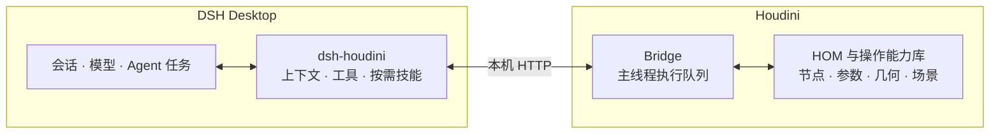

# dsh-houdini


**用自然语言构建、检查和维护可编辑的 Houdini 工程。**

dsh-houdini 将 Houdini 的真实场景接入 [DeepSeek Harness Desktop](https://github.com/deepseek-ai/deepseek-harness)。在同一份对话中描述目标，Agent 可以读取场景、创建和修改节点、调整参数、制作工具，并根据实际执行结果继续迭代。

主要产物保留为原生节点网络、控制参数、关键帧、HDA 和工程文件。你可以查看构建过程、手工编辑结果，也可以继续通过对话提出修改。

[核心能力](#核心能力) · [快速开始](#快速开始) · [工作原理](#工作原理) · [文档](#文档)

## 核心能力

| 能力 | 可以完成的工作 |
|---|---|
| 场景理解与诊断 | 读取节点、参数、连接和几何信息，检查 Cook 错误与依赖，结合界面截图和预览定位问题。 |
| 程序化建模 | 使用 SOP、属性、VEX 和 Python 搭建可编辑网络，暴露控制参数，进行局部修改与几何检查。 |
| HDA 与艺术家工具 | 将流程封装为 HDA，制作参数界面、Shelf、Python Panel、Viewer State 和 Package，组织源码、资源与使用入口。 |
| 材质、灯光与渲染 | 处理 UV 与贴图，搭建 MaterialX / Solaris / Karma 工作流，配置相机、灯光并生成预览或渲染输出；按需使用 COP 图层与图像处理。 |
| 参数控制与动画 | 设置参数依赖和关键帧，组织机械层级、绑定与动画网络，观察控制量变化后的实际输出。 |
| 参考资料辅助 | 使用图文、参考图和视频资料辅助工作；通过配置的模型生成或编辑图片，转录讲解、抽取画面并整理有来源依据的步骤。 |
| 工程组织与交付 | 整理节点命名、分组、子网、输出和资源路径，保存 HIP、工具源码与相关文件，便于继续修改和复用。 |
| 长任务与执行接续 | 通过 DSH 后台任务观察渲染或计算，查回原请求结果，在独立 Houdini 进程中构建与验证，并查看执行记录和错误。 |

这些能力可以组合使用：从检查现有网络开始，逐步改成参数化资产，再封装为工具；也可以从参考资料出发，构建场景并制作展示。具体方法由 Agent 根据你的目标、已有工程和当前可用能力选择。

## 快速开始

### 环境要求

| 项目 | 支持范围 |
|---|---|
| 操作系统 | Windows x64 |
| 宿主 | DSH 0.2.1-rc.5（首选）及 DSH 0.2.1-rc.3；精确范围与验证边界见[兼容清单](dsh-runtime-compatibility.json) |
| Houdini | 21.0 / 22.0；构建兼容信息见[安装说明](docs/setup.md) |
| 模型 | 在 DSH 中配置可用的主聊天模型；图像理解、生图和语音按所用模型与服务的实际能力配置 |

### 安装

1. 安装兼容的官方 DSH Desktop 和 Houdini，在 DSH 原生模型设置中配置主模型。
2. 在 Desktop 的 **插件 → 添加插件 → 包名或地址** 中粘贴下方正式包地址，点击 **安装**；也可填入已下载完整 `.tgz` 的本地绝对路径。
3. 点击 **立即启用**，或在插件列表启用 `dsh-houdini`。

```text
https://github.com/eee1723/dsh-houdini/releases/download/v0.1.4/dsh-houdini-0.1.4.tgz
```

[正式发布与校验文件](https://github.com/eee1723/dsh-houdini/releases/tag/v0.1.4)。当前通过 GitHub 完整包直链安装，未上架 npm；直接粘贴地址即可，无须解压或运行脚本。已有 0.1.1～0.1.3 用户需先按[更新说明](docs/setup.md#connection--support连接与维护)完成这次更新，之后才能使用新增的更新提醒。

新装插件默认停用，启用后才会提供 Houdini 模式。完整包包含 FFmpeg / ffprobe，普通 Python 自动从 Houdini 安装定位；使用插件无需另装 Node、编译源码或配置 FFmpeg PATH。

安装、组件更新、旧入口迁移及卸载详见[安装与使用指南](docs/setup.md)。

### 连接场景

| 入口 | 操作方式 |
|---|---|
| 从 DSH Desktop 进入 | 新建或选择 **Houdini 模式** 的对话，在工程控件中绑定已连接窗口，或选择 Houdini 安装后新建场景、打开 HIP。 |
| 从 Houdini 进入 | 使用 **DSH-Houdini → Open Workspace**，根据当前工程进入同一个 Desktop 中的对应 Houdini 对话。 |

插件在真正新开 Houdini 前自动准备连接组件。已有窗口若尚未加载兼容组件，先在 Desktop 工程控件中选择 **安装 / 更新 Houdini 组件**，再保存并重开对应窗口。每段对话可以明确选择自己的工程；打开其他 HIP 默认使用新进程，保留已有窗口。

Houdini 相关控件随当前对话的 **Houdini 模式** 显示，其他模式继续使用 DSH 原有界面。多工程选择、工作区与工程接续见[工程使用说明](docs/multi-instance.md)。

Windows Desktop的Houdini模式提供 **置顶** 按钮，便于同时操作场景和对话；返回其他模式时恢复原来的窗口层级。需要ChatGPT/Codex订阅时，可通过官方插件管理安装社区插件 [dsh-codex-subscription@3.1.8](https://github.com/WSL043/dsh-codex-subscription)；它独立授权和维护，不随Houdini发行包捆绑，模型仍从DSH原生菜单选择。

## 使用示例

可以直接描述目标、要修改的范围和希望保留的内容。例如：

**创建参数化资产**

> 在当前场景中新建一套螺旋楼梯，暴露踏步数、宽度和总高。保留可编辑的 SOP 网络，并检查改变参数后踏步之间的关系。

**检查和修改已有网络**

> 检查我选中的节点链为什么没有几何输出。在这条链内定位并修复问题，保留其他网络，说明改动和检查结果。

**制作可复用工具**

> 把这套生成器封装为 HDA，整理输入输出和参数界面，在新实例中检查，并说明文件位置和加载方式。

**完成材质与展示**

> 在这个已保存的工程中，为选中资产配置 MaterialX 材质、Karma 灯光和相机，输出一张预览，检查材质绑定与渲染错误。

**利用教程资料**

> 分析这个视频中的构建方法，先整理关键步骤、参数和来源时间，再在 Houdini 中分阶段复现，标出原视频中看不清的部分。

任务可以从观察、构建、修改或排错中的任意一步开始。修改现有工程时，请明确对象和范围；交付时可以要求 Agent 展示关键网络、控制参数、实际输出与文件位置。模型提出的方案仍应结合几何、画面和工程检查判断效果。

## 工作原理

DSH 提供对话与通用 Agent 能力，插件将模型的操作连接到真实 Houdini。工程操作的主要链路如下：



| 部分 | 职责 |
|---|---|
| DSH Desktop | 管理模型、账户、凭据、会话、工作区和通用任务，承载用户与 Agent 的持续交互。 |
| 插件适配层 | 提供 Houdini 模式、工程上下文、工具与界面，按任务加载领域技能，呈现执行结果。 |
| Houdini Bridge | 在 Houdini 内接收请求，核对工程身份与操作范围，通过主线程队列执行操作并返回真实结果。 |

Houdini 的 Python API（HOM）只在 Houdini 侧运行。媒体准备在普通 Python 工作进程中执行，独立构建与验证使用一次性 Houdini 进程；它们与当前场景的主线程执行分开。

执行结果、错误、图片和文件返回原对话，支持在实际结果上继续修改。请求响应丢失时可以查回原请求，减少重复操作；长任务由 DSH 跟踪，同一 Houdini 工程中的操作仍按队列串行执行。

详细职责与源码入口见[系统架构](docs/architecture.md)，工具参数见[工具说明](docs/tools.md)与[操作能力目录](docs/tool-design.md)。

## 模型与扩展配置

主聊天模型、账户和凭据统一在 DSH 原生设置中管理。需要看图时使用具备图片输入能力的模型；图片生成或编辑可使用单独配置的图片服务。

语音转录在实际需要时配置。在任意模式的 **设置 → 教程视频** 选择地址来源、实际协议和准确模型，确认调度后直接保存，无须先发起模型对话；对话中也可让 Agent 使用同一份配置。API Key 直接在安全输入框录入 DSH 凭据服务，不作为聊天答案。

已有 DSH 提供方可以明确复用，独立语音服务也可按实际接口接入。只做媒体解析不必先连接场景。配置方法、依赖与接口范围见[模型及媒体设置](docs/setup.md#教程视频与转录设置)。

## 文档

| 入口 | 内容 |
|---|---|
| [安装与使用](docs/setup.md) | 安装、连接、更新、迁移、模型配置与卸载 |
| [多工程与接续](docs/multi-instance.md) | 多窗口、明确绑定、工作区和工程恢复 |
| [工具说明](docs/tools.md) | 工具职责、参数与返回 |
| [操作能力目录](docs/tool-design.md) | 节点、参数、几何、资产、观察与渲染操作 |
| [工程文件与输出](docs/project-files.md) | HIP、图片、资源及输出目录 |
| [执行记录与诊断](docs/houdini-trace-design.md) | Trace 中的执行、资料与诊断信息 |
| [故障报告](docs/support-reports.md) | 收集、检查和导出诊断资料 |
| [文档索引](docs/README.md) | 完整设计、接口与维护说明 |

<details>
<summary>按需加载的领域技能</summary>

| 领域 | 用途 |
|---|---|
| [任务拆分](skills/houdini-task-decomposition/SKILL.md) | 按目标与依赖组织模块、观察和集成 |
| [独立执行](skills/houdini-isolated-execution/SKILL.md) | 在独立 Houdini 进程中构建与验证 |
| [SOP](skills/houdini-sop-workflow/SKILL.md) | 程序化建模、曲线与几何操作 |
| [模拟](skills/houdini-simulation-workflow/SKILL.md) | 反馈求解、时序、缓存与模拟修改 |
| [表面外观](skills/houdini-surface-workflow/SKILL.md) | 参考图、表面细节、UV 与贴图 |
| [COP](skills/houdini-cop-workflow/SKILL.md) | 按需进行图层与图像处理 |
| [工具开发](skills/houdini-tool-development/SKILL.md) | HDA、脚本、面板与工具交付 |
| [参数界面](skills/houdini-parameter-ui/SKILL.md) | 控制参数、界面组织与绑定 |
| [网络交接](skills/houdini-network-handoff/SKILL.md) | 节点入口、分组、说明与布局 |
| [Rig 与动画](skills/houdini-rig-animation-workflow/SKILL.md) | 骨架、层级与动画 |
| [Solaris 与 Karma](skills/houdini-solaris-karma-workflow/SKILL.md) | 材质、USD 与渲染 |
| [视频教程](skills/houdini-video-tutorial/SKILL.md) | 转录、画面依据与教学工程 |
| [Trace 分析](skills/houdini-trace-analysis/SKILL.md) | 查看请求、工具调用和失败原因 |
| [知识维护](skills/houdini-skill-governance/SKILL.md) | 按明确请求维护领域资料 |

</details>

## 开发与反馈

源码构建与检查：

```powershell
npm install
npm run build
npm run docs:check
npm test
```

扩展职责、接口和验证方法见[开发规范](docs/development.md)与[架构代码地图](docs/architecture.md)。问题和建议可以提交到 [GitHub Issues](https://github.com/eee1723/dsh-houdini/issues)；报告时请说明操作目标、版本、现象和复现步骤，并按[故障报告指南](docs/support-reports.md)检查需要分享的内容。
